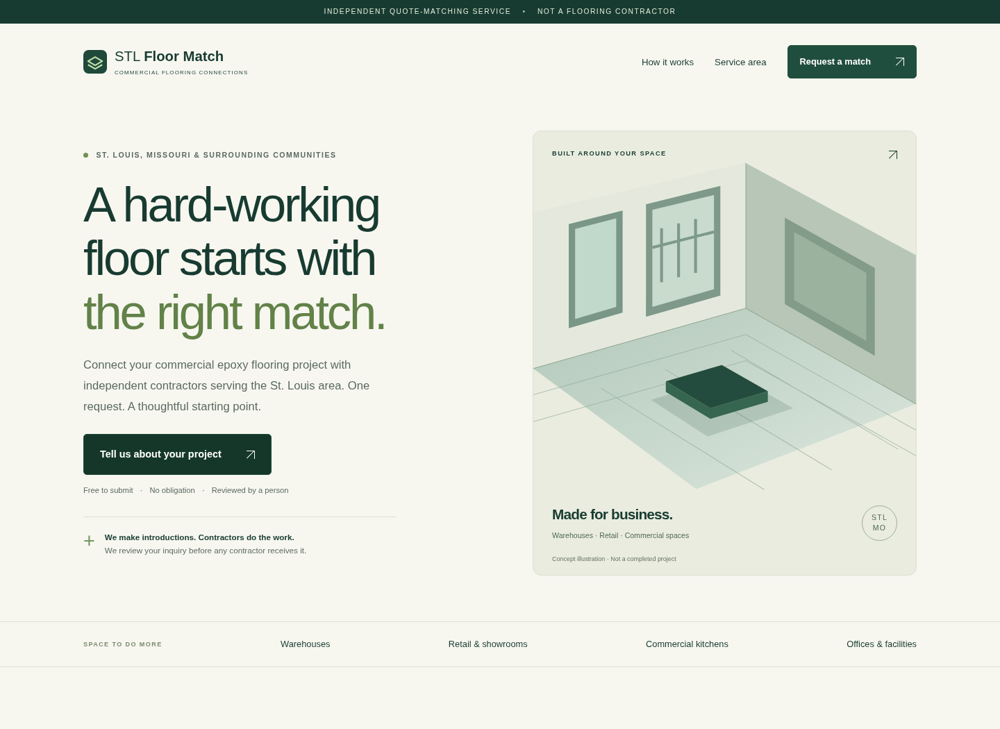

# STL Floor Match · Epoxy

A commercial epoxy-flooring quote-matching website for the St. Louis, Missouri area.
**The operator is not a contractor.** All inquiries are held for manual review.
There is no contractor delivery code, automatic marketing, public deployment, or paid account creation.



[See the phone layout](docs/images/mobile.png) · [See variation B](docs/images/variation-b.png)

## See the site

The local development server is started with:

```sh
python3 -m venv .venv
.venv/bin/python -m pip install -r requirements-dev.txt
.venv/bin/python manage.py init
.venv/bin/python manage.py set-password
.venv/bin/python serve.py
```

Open port 8000 in your own local browser when running on your computer.
This cloud onboarding interface does not provide a live localhost web preview.
Screenshots from the tested app are in the ignored `artifacts/` folder.

- Home version A: `/` or `/?v=a`
- Home version B: `/?v=b`
- Confirmation: `/thanks`
- Privacy: `/privacy`
- Private dashboard: `/admin`

Both variants use the same form, disclosures, and qualification rules. A is the default.
The version persists in the session; no random A/B experiment is running.

**Non-programmer launch guide:** [docs/LAUNCH.md](docs/LAUNCH.md)

**Security and operating instructions:** [docs/OPERATIONS.md](docs/OPERATIONS.md)

## What is included

- Responsive pages, original architectural illustration (not a customer project), accessible labels,
  native browser validation plus server validation, and visible error summaries.
- ZIP, size, project type, and timeframe qualification. Every lead routes to the owner approval queue.
- Authenticated dashboard, pagination, internal review/archive, permanent deletion, and consent record.
- Encrypted lead content with Fernet, hashed duplicate fingerprints, parameterized SQLite queries,
  signed sessions, CSRF protection, security headers, honeypot, minimum form time, and persistent rate limits.
- Owner-only email outbox with retries. Emails contain a dashboard link, not customer details.
- First-party visitor, form-start, submission, qualification, and conversion metrics split by variation.
  No third-party analytics account, advertising pixels, raw IP storage, or marketing messages.
- Single-service runner: Gunicorn, notification jobs every minute, hourly retention cleanup, and
  private daily SQLite backups retained seven days. Uses one persistent disk.

## Tests

```sh
.venv/bin/python -m pytest -q
# Uses an installed Chromium if present. On your own computer if needed:
.venv/bin/python -m playwright install chromium
.venv/bin/python tests/browser_checks.py
```

For an existing system browser use `CHROMIUM_PATH=/path/to/chromium`.
Browser checks use an isolated temporary database, two variations, and four viewport sizes.
They submit synthetic data and test the private dashboard. Email tests mock SMTP;
**live email deliverability has not been verified**.

## Configuration

See [.env.example](.env.example). Never commit a populated `.env`, database, or encryption keys.
`manage.py init` preserves existing configuration. Initially the admin password is random and unknown;
`set-password` enables access with a password you choose. Restart the service after changing settings.

`MIN_SQFT` defaults to 500. `SERVICE_ZIPS` is a comma-separated exact ZIP list.
Unknown areas and small projects are retained for manual review, not rejected.
Project-type and timeframe qualification lists are configurable in `create_app` overrides;
see `QUALIFY_TYPES` and `QUALIFY_TIMES`. All supported choices qualify by default.
An email or normalized US phone repeated within 24 hours is suppressed, even on a new form.
Retried submissions return the same generic confirmation without creating another lead or email.

## Stack and reuse

Python 3.12+, Flask, SQLite, Gunicorn, and a transactional SMTP provider.
No Node build, database subscription, external fonts, stock photos, or paid analytics.
`requirements.txt` pins runtime dependencies; `requirements-dev.txt` adds test tools.
`requirements.in` documents the direct runtime dependencies.

To adapt another market, reuse the encrypted intake, consent, dashboard, outbox, and analytics modules.
Set `SITE_NAME`, `SITE_REGION`, `SERVICE_ZIPS`, and qualification settings; edit the market-specific copy
in `templates/home.html`, navigation branding, SEO title, and privacy text. Project choices live in
`TYPES`/`TIMES`. Use a separate database, encryption key, domain, and consent review per business.
Consent records substitute the configured site name. A second market needs its own coverage and contractor agreement.
